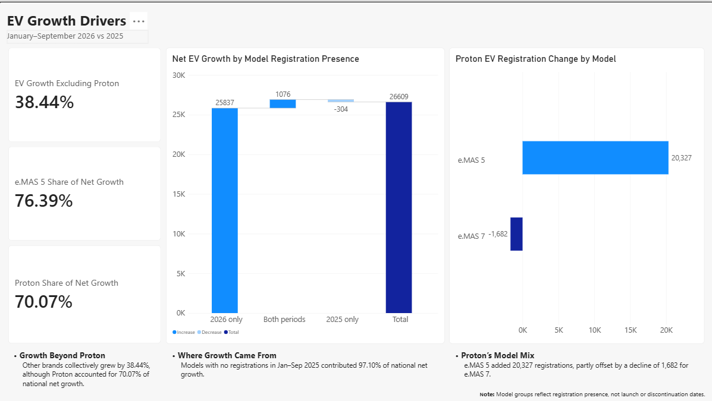

# Malaysia Car Registrations & EV Market Analysis

Comparing Malaysia's car registrations and battery electric vehicle (EV) market in January–September 2025 and 2026.

**Tools:** PostgreSQL 18, SQL, Power BI Desktop, DAX, Power Query, VS Code

## Project Objective

Measure how EV registrations and market share changed year over year, then identify the months, brands and models contributing most to the increase.

## Key Takeaways

- **EV registrations nearly doubled:** registrations rose by 98.82%, reaching an 8.35% share of total car registrations.
- **Growth extended beyond Proton:** registrations excluding Proton increased by 38.44%.
- **One model accounted for most of the net increase:** Proton e.MAS 5 contributed 76.39% of national EV net growth.

## Power BI Report

[Download the Power BI report](malaysia-ev-overview.pbix?raw=true)

### Market Overview

Period totals, year-over-year changes, monthly EV registrations and changes in EV share.

### Brands & Models

The five largest brand registration gains and declines, EV market shares for the top five brands by 2026 registrations, and model-level comparisons. Market shares retain the national EV denominator. The brand selector filters the model table while the two brand charts retain the market-wide comparison.

### Growth Drivers

Growth excluding Proton, Proton and e.MAS 5 contributions to national net growth, a waterfall breakdown by model registration presence, and Proton's model-level registration changes.

## Market Overview

| Metric | Jan–Sep 2025 | Jan–Sep 2026 | Change |
|---|---:|---:|---:|
| Total car registrations | 613,952 | 640,875 | +4.39% |
| EV registrations | 26,928 | 53,537 | +26,609 (+98.82%) |
| EV share of car registrations | 4.39% | 8.35% | +3.97 percentage points |

EV registrations nearly doubled while total car registrations grew by 4.39%.

### Key Findings

- EV registrations increased year over year in all nine months.
- **August recorded the largest increase:** 5,372 additional EV registrations, from 3,461 to 8,833.
- **January had the highest growth rate:** 268.95%, from a smaller base of 1,691 registrations.

[View the market overview and monthly comparison SQL](sql/05_market_overview.sql)

## Brands & Models

Brand rankings use standardized `maker` labels from the source data and do not consolidate manufacturers into automotive groups or a unified commercial brand classification. Model comparisons use maker–model label combinations; unverified aliases remain separate.

### EV Market Shares — Top 3 Brands in 2026

| Maker | Jan–Sep 2025 | Jan–Sep 2026 | Change (percentage points) |
|---|---:|---:|---:|
| Proton | 23.07% | 46.43% | +23.36 |
| BYD | 31.26% | 15.11% | -16.15 |
| Tesla | 14.29% | 8.29% | -6.00 |

Shares use total EV registrations as the denominator. Tesla's registrations increased from 3,847 to 4,436, but its share declined as the overall EV market grew faster.

### Brand Registration Gains and Declines

The largest absolute changes identify which brands expanded or contracted most during the comparison period.

| Growth leaders | Net change | Decline leaders | Net change |
|---|---:|---|---:|
| Proton | +18,645 | BMW | -598 |
| Chery | +3,073 | Denza | -418 |
| Zeekr | +2,430 | Mercedes Benz | -387 |
| Leapmotor | +1,401 | Porsche | -331 |
| TQ Wuling | +708 | BYD | -330 |

### Growth Without Market-Share Gains

Nine brands increased EV registrations while losing EV market share because their growth lagged the national rate of 98.82%.

- **Tesla had the largest net increase in this group:** +589 registrations (+15.31%), contributing 2.21% of national net growth, while its share fell by 6.00 percentage points.
- **High percentage growth did not guarantee share gains:** Honda grew by 84.21%, but this represented only 64 additional registrations and remained below national market growth.

### Gains and Declines Among Models Registered in Both Periods

The following rankings cover the 66 maker–model combinations registered in both comparison periods, rather than all EV models.

| Brand | Model | Jan–Sep 2025 | Jan–Sep 2026 | Net change | YoY growth |
|---|---|---:|---:|---:|---:|
| **Five largest gains** | | | | | |
| Zeekr | 7X | 234 | 2,796 | +2,562 | +1,094.87% |
| BYD | Seal 6 | 58 | 1,402 | +1,344 | +2,317.24% |
| Chery | iCaur 03 | 35 | 710 | +675 | +1,928.57% |
| Tesla | Model 3 | 1,412 | 2,080 | +668 | +47.31% |
| BYD | Atto 3 | 2,665 | 3,235 | +570 | +21.39% |
| **Five largest declines** | | | | | |
| Proton | e.MAS 7 | 6,212 | 4,530 | -1,682 | -27.08% |
| BYD | Sealion | 2,709 | 1,610 | -1,099 | -40.57% |
| BYD | Seal | 886 | 228 | -658 | -74.27% |
| BYD | M6 | 1,261 | 608 | -653 | -51.78% |
| Denza | D9 | 850 | 341 | -509 | -59.88% |

The five largest gains added 5,819 registrations, while the five largest declines removed 4,601. The remaining 56 combinations together declined by 142, reconciling to the group's net increase of 1,076. In total, 35 of the 66 combinations declined. Small prior-period bases explain some of the largest percentage gains, so rankings use absolute registration changes.

[View brand comparisons](sql/06_brand_analysis.sql), [brand market shares](sql/08_brand_market_share.sql), and [model comparisons](sql/07_model_analysis.sql). The combined growth and share screening is in [the growth-driver SQL](sql/09_growth_drivers.sql).

## Growth Drivers

### Growth Beyond Proton

| Market scope | Jan–Sep 2025 | Jan–Sep 2026 | Net change | YoY growth | National net growth contribution |
|---|---:|---:|---:|---:|---:|
| All EV | 26,928 | 53,537 | +26,609 | +98.82% | 100.00% |
| Proton | 6,212 | 24,857 | +18,645 | +300.14% | 70.07% |
| Excluding Proton | 20,716 | 28,680 | +7,964 | +38.44% | 29.93% |

Proton supplied most of the net increase, but other brands collectively grew by 38.44%. This grouping describes observed registrations; it does not estimate what the market would have done without Proton.

### Model Growth Sources

| Registration presence | Maker–model combinations | Jan–Sep 2025 | Jan–Sep 2026 | Net change | National net growth contribution |
|---|---:|---:|---:|---:|---:|
| 2026 only | 31 | 0 | 25,837 | +25,837 | 97.10% |
| Both periods | 66 | 26,624 | 27,700 | +1,076 | 4.04% |
| 2025 only | 37 | 304 | 0 | -304 | -1.14% |
| **Total** | **134** | **26,928** | **53,537** | **+26,609** | **100.00%** |

- **Growth was concentrated in combinations with no registrations in the earlier period:** the 31 combinations registered only in Jan–Sep 2026 contributed 97.10% of national net growth.
- **e.MAS 5 dominated this group:** its 20,327 registrations represented 78.67% of the group's volume and 76.39% of national net growth. Other leading contributors included Chery iCaur V23 (+1,829), Leapmotor B10 (+961) and TQ Wuling Bingo (+708).
- **Proton's model trends differed:** e.MAS 5 added 20,327 registrations, partly offset by a decline of 1,682 for e.MAS 7, leaving a brand net increase of 18,645.

Group labels refer to registration presence in January–September of each year, not launch or discontinuation dates.

[View the growth-driver analysis SQL](sql/09_growth_drivers.sql).

## Data & Scope

Source: [JPJ Car Registration Transactions — data.gov.my](https://data.gov.my/data-catalogue/registration_transactions_car).

This report uses a fixed local data snapshot to compare January–September 2025 and 2026, with an analysis cutoff of 30 September 2026. It is not a live market tracker. The original download date was not recorded.

| Source file | Coverage | Records |
|---|---|---:|
| [cars_2025.csv](data/raw/cars_2025.csv) | January–December 2025 | 870,188 |
| [cars_2026.csv](data/raw/cars_2026.csv) | January–September 2026 | 640,875 |

- Comparisons use **January–September only** in both years.
- Cars include motorcars, MPVs, jeeps, pick-up trucks and window vans, following the source dataset's classification.
- EV means `fuel = 'electric'`; hybrids are excluded.
- Each row counts as one registration. Identical public fields are not sufficient evidence to remove a record.
- EV share uses total EV registrations divided by total car registrations. Share changes are calculated before rounding.
- Net growth contribution uses a brand, model or group's registration change divided by the national EV net increase of 26,609. Negative contributions offset growth; contributions can exceed 100% when other groups decline.
- These figures measure registrations, not sales.
- Results describe the downloaded transaction files; they do not establish the causes of market changes. Year-over-year growth is left blank when the prior-year count is zero.

## Data Preparation & Validation

SQL preserves the raw registration records and applies confirmed naming corrections through a separate cleaning view:

- Standardize maker `Icaur` to `iCaur`.
- Standardize maker `Jac` to `JAC`.
- Remove the trailing space from Honda's `E Advance ` model label.

Checks covered imported row counts, month coverage, missing values and naming consistency. All 18 comparison months contain records, with no null registration dates and no missing fuel types, makers or models under the implemented checks. Monthly, brand and model EV totals reconcile to the period totals. Unrounded brand shares sum to 100% in each period.

Model analysis retains 134 maker–model label combinations. Their totals reconcile to the national overview and all 56 maker totals. Model aliases and cross-brand naming differences remain separate unless a mapping has been verified; these labels are not a count of distinct vehicle designs.

Power BI uses DAX measures for period comparisons, market shares and growth contributions. Displayed card and chart values reconcile to the SQL results above.

## SQL Files

| File | Purpose |
|---|---|
| [00_setup.psql](sql/00_setup.psql) | Create the database if needed, load data and run initial validation |
| [01_create_table.sql](sql/01_create_table.sql) | Define the raw registration table |
| [02_import_data.psql](sql/02_import_data.psql) | Reload both CSV files in one transaction |
| [03_validate_data.sql](sql/03_validate_data.sql) | Check database, record counts, date ranges and September 2026 totals |
| [04_data_quality.sql](sql/04_data_quality.sql) | Check month coverage, missing fields and fuel values |
| [04b_create_clean_view.sql](sql/04b_create_clean_view.sql) | Create the cleaning view and validate counts and maker labels |
| [05_market_overview.sql](sql/05_market_overview.sql) | Calculate period totals, annual changes and monthly EV comparisons |
| [06_brand_analysis.sql](sql/06_brand_analysis.sql) | Review maker names and compare EV registrations by brand |
| [07_model_analysis.sql](sql/07_model_analysis.sql) | Compare maker–model registrations and reconcile national and maker totals |
| [08_brand_market_share.sql](sql/08_brand_market_share.sql) | Compare each maker's share of EV registrations and percentage-point changes |
| [09_growth_drivers.sql](sql/09_growth_drivers.sql) | Compare growth excluding Proton, identify growing brands losing share, and analyze model registration groups and declines |

