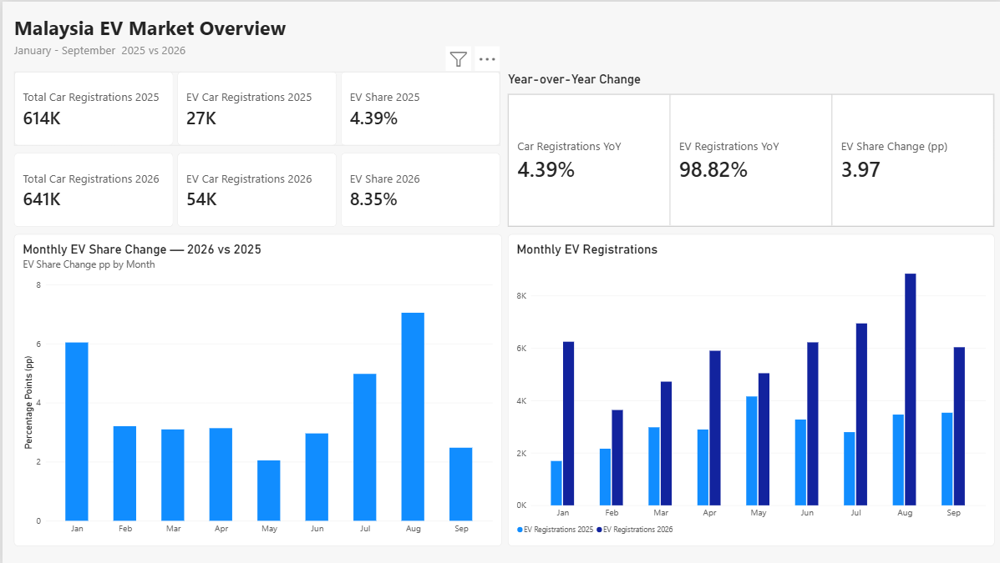

# Malaysia Car Registrations & EV Market Analysis

Comparing Malaysia's car registrations and battery electric vehicle (EV) market in January–September 2025 and 2026.

**Tools:** PostgreSQL 18, SQL, Power BI Desktop, DAX, Power Query, VS Code

## Project Objective

Measure how EV registrations and market share changed year over year, then identify the months, brands and models contributing most to the increase.

## Power BI Report

[Download the Power BI report](malaysia-ev-overview.pbix?raw=true)

### Market Overview

Period totals, year-over-year changes, monthly EV registrations and changes in EV share.

### Brands & Models

Brand registration changes, EV market shares and model-level comparisons. The brand selector filters the model table while the two brand charts retain the market-wide comparison.

## Market Overview

| Metric | Jan–Sep 2025 | Jan–Sep 2026 | Change |
|---|---:|---:|---:|
| Total car registrations | 613,952 | 640,875 | +4.39% |
| EV registrations | 26,928 | 53,537 | +26,609 (+98.82%) |
| EV share of car registrations | 4.39% | 8.35% | +3.97 percentage points |

EV registrations nearly doubled while total car registrations grew by 4.39%.

### Key Findings

- EV registrations increased year over year in all nine months.
- **August recorded the largest increase:** 5,372 additional EV registrations, from 3,461 to 8,833.
- **January had the highest growth rate:** 268.95%, from a smaller base of 1,691 registrations.
- **Proton contributed 70.07% of the net EV increase:** registrations rose from 6,212 to 24,857, adding 18,645.
- **Proton's growth came from e.MAS 5:** its registrations increased from zero to 20,327, while e.MAS 7 battery electric registrations fell by 1,682.

[View the market overview and monthly comparison SQL](sql/05_market_overview.sql)

### EV Brand Shares

| Maker | Jan–Sep 2025 | Jan–Sep 2026 | Change (percentage points) |
|---|---:|---:|---:|
| Proton | 23.07% | 46.43% | +23.36 |
| BYD | 31.26% | 15.11% | -16.15 |
| Tesla | 14.29% | 8.29% | -6.00 |

Shares use total EV registrations as the denominator. Tesla's registrations increased from 3,847 to 4,436, but its share declined as the overall EV market grew faster.

## Data & Scope

Source: [JPJ Car Registration Transactions — data.gov.my](https://data.gov.my/data-catalogue/registration_transactions_car).

| Source file | Coverage | Records |
|---|---|---:|
| [cars_2025.csv](data/raw/cars_2025.csv) | January–December 2025 | 870,188 |
| [cars_2026.csv](data/raw/cars_2026.csv) | January–September 2026 | 640,875 |

- Comparisons use **January–September only** in both years.
- EV means `fuel = 'electric'`; hybrids are excluded.
- Each row counts as one registration. Identical public fields are not sufficient evidence to remove a record.
- EV share uses total EV registrations divided by total car registrations. Share changes are calculated before rounding.
- These figures measure registrations, not sales.
- Results describe the downloaded transaction files; they do not establish the causes of market changes. Year-over-year growth is left blank when the prior-year count is zero.

## Data Preparation & Validation

SQL loads the source files into a raw table and applies cleaning through a separate view. Power BI imports the cleaned records, filters both years to January–September, and uses a calendar table and DAX measures for comparisons.

Checks covered imported row counts, date coverage, missing values and naming consistency. All 18 comparison months contain records, with no missing dates, fuel types, makers or models under the implemented checks. Monthly, brand and model EV totals reconcile to the period totals. Unrounded brand shares sum to 100% in each period.

Model analysis retains 134 maker–model label combinations. Their totals reconcile to the national overview and all 56 maker totals. Model aliases and cross-brand naming differences remain separate unless a mapping has been verified; these labels are not a count of distinct vehicle designs.

## SQL Files

| File | Purpose |
|---|---|
| [00_setup.psql](sql/00_setup.psql) | Create the database if needed, load data and run initial validation |
| [01_create_table.sql](sql/01_create_table.sql) | Define the raw registration table |
| [02_import_data.psql](sql/02_import_data.psql) | Reload both CSV files in one transaction |
| [03_validate_data.sql](sql/03_validate_data.sql) | Check database, record counts, date ranges and September 2026 totals |
| [04_data_quality.sql](sql/04_data_quality.sql) | Check month coverage, missing fields and fuel values |
| [04b_create_clean_view.sql](sql/04b_create_clean_view.sql) | Create the cleaning view and validate counts and maker labels |
| [05_market_overview.sql](sql/05_market_overview.sql) | Calculate period totals, annual changes and monthly EV comparisons |
| [06_brand_analysis.sql](sql/06_brand_analysis.sql) | Review maker names and compare EV registrations by brand |
| [07_model_analysis.sql](sql/07_model_analysis.sql) | Compare maker–model registrations and reconcile national and maker totals |
| [08_brand_market_share.sql](sql/08_brand_market_share.sql) | Compare each maker's share of EV registrations and percentage-point changes |

